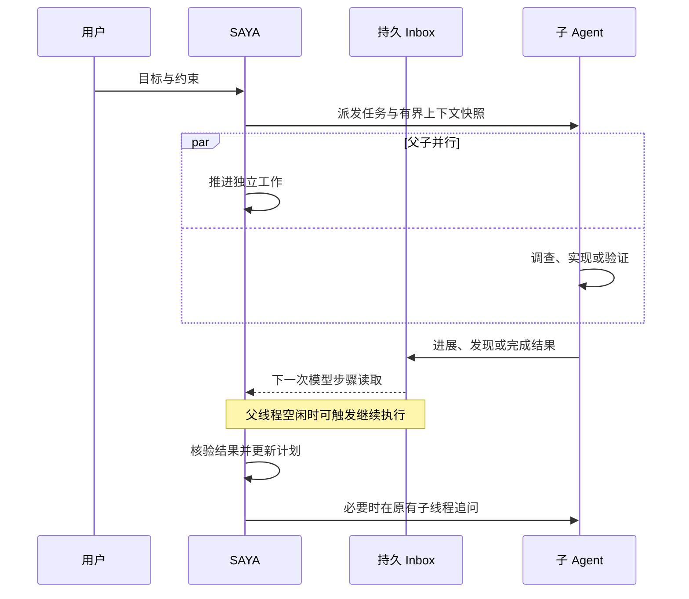
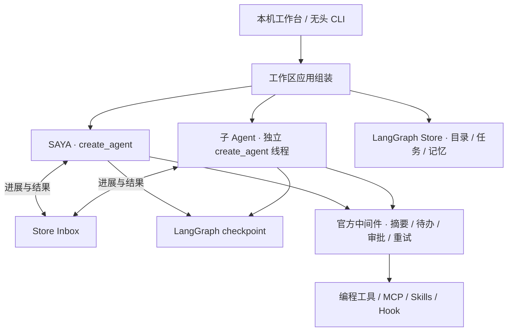

<div align="center">
  

  <h1>SAYACODE</h1>
  <p><strong>可规划、可协作、可恢复的本机编程 Agent。</strong></p>
  <p>从理解代码到实施、验证与交付，让长任务在独立线程中持续推进，让每一步都有状态可查。</p>

  <p>
    <a href="#核心能力">核心能力</a> ·
    <a href="#快速开始">快速开始</a> ·
    <a href="#异步多-agent-协作">多 Agent 协作</a> ·
    <a href="#上下文与长期记忆">上下文与记忆</a> ·
    <a href="#架构与状态归属">运行架构</a> ·
    <a href="https://github.com/saya-ch/sayacode/blob/main/docs/webui.md">使用指南</a>
  </p>

  <p>
    <a href="https://pypi.org/project/sayacode/"></a>
    <a href="https://pypi.org/project/sayacode/"></a>
    <a href="https://github.com/saya-ch/sayacode/actions/workflows/ci.yml"></a>
    <a href="https://github.com/saya-ch/sayacode/blob/main/LICENSE"></a>
    <a href="https://docs.langchain.com/oss/python/langchain/overview"></a>
    <a href="https://docs.langchain.com/oss/python/langgraph/overview"></a>
  </p>
</div>

---

SAYACODE 是基于 **LangChain / LangGraph** 的开源编程助手，在本机工作区读取代码、执行工具、组织子任务并交付修改。主 Agent **SAYA** 负责整体目标；子 Agent 可以并行调查、实现和审查，也可以在同一线程上接受追问、继续工作。

Agent 循环由 LangChain `create_agent` 构建，工具调度、消息、待办、摘要与审批中断使用框架原生机制。SAYACODE 提供面向编程任务的工具、协作与交付适配，并通过本机 Web 工作台或无头 CLI 使用同一套运行能力。

## 核心能力

| 能力 | 实现与体验 |
| --- | --- |
| **工具式规划与动态重规划** | 使用原生 `write_todos` 维护线程计划；根据验证失败、新需求和子任务结果调整后续步骤。 |
| **可继续的异步子 Agent** | `builder / planner / reviewer` 各有独立线程、上下文与检查点；父 Agent 继续工作，子 Agent 可追问、停止和恢复。 |
| **持久消息与主动回报** | 父子通过 Inbox 交换进展和结果，在下一次模型步骤进入上下文；空闲父线程可因通知继续执行。 |
| **可审阅的代码交付** | builder 可共享工作区或使用独立 Git worktree；快照包含未提交内容，新增差异由用户显式应用。 |
| **长任务上下文管理** | 自动摘要、手动聚焦压缩、工具输出落盘、Skill 渐进加载与有预算的记忆召回。 |
| **可治理的跨会话记忆** | 用户偏好与项目事实分域保存，支持来源依据、有效性核验、更正、确认、固定和遗忘。 |
| **原生审批与恢复** | 四档信任策略、逐项审批、相同调用授权；中断保存在 checkpoint，批准后从原图继续。 |
| **Skills、MCP 与 Hook** | 按需加载任务方法，通过官方 MCP 适配器扩展工具，在六类生命周期事件接入项目自动化。 |
| **面向真实仓库的工具** | 文件与精确编辑、原生 Shell、只读 Git、文件搜索、Tree-sitter 符号分析和 Web 搜索。 |
| **按协议接入模型** | 五类协议、独立模型配置；主线程与子线程可分别选择模型，不按供应商名称猜测接口。 |
| **可观察、可干预的执行** | 流式正文、模型与工具轨迹、计划、Agent 关系、审批和交付；支持排队补充、直接插话与整树停止。 |
| **本机运行与脚本集成** | SQLite 持久化，`pip` 安装即用；提供 `text / json / jsonl` 无头输出和诊断接口。 |

## 快速开始

支持 **Windows / Linux** 与 **Python 3.11–3.13**。安装发行包不需要 Node.js：

```bash
python -m pip install --upgrade sayacode
sayacode --workspace .
```

启动后会打开本机 Web 工作台。在输入框底部的设置入口添加模型连接，然后选择工作区、创建会话并发送任务。没有模型配置时，工作台仍可正常打开以完成设置。

```bash
sayacode --no-open        # 启动服务，不自动打开浏览器
sayacode --port 8765      # 指定本机端口
sayacode --port 0         # 自动选择可用端口
```

默认只监听 `127.0.0.1`。关闭浏览器不会结束 Agent；退出 CLI 进程会请求停止运行并保存检查点，后续由用户显式恢复。本地状态默认位于 `~/.sayacode/`，可用 `SAYACODE_HOME` 指定存储目录。界面支持中文、English 和跟随浏览器。

### 从一个真实任务开始

```text
先了解这个项目，再修复登录失败后的重试问题。

让 planner 调查认证流程，让 reviewer 独立检查并发与错误处理，
你继续分析测试入口。确定方案后交给 builder 实现，
最后核对差异、运行相关测试，并根据实际结果更新计划。
```

SAYA 可以用待办组织工作、派发独立任务，并在收到调查或验证结果后调整计划。你可以查看各线程的执行轨迹、补充约束、处理审批，再决定是否应用独立 worktree 的交付。具体派发与工具选择由所接入模型决定。

## 工具式规划与执行

规划直接融入 Agent 的工具调用流程。`TodoListMiddleware` 提供原生 `write_todos`，每个线程只维护一份计划，状态为 `pending / in_progress / completed`。

1. **Plan**：为多阶段任务写出可验证的目标，明确独立工作和依赖。
2. **Execute**：读取代码、编辑文件、运行验证，必要时派发子 Agent。
3. **Replan**：出现失败证据、需求变化或子任务发现时，更新剩余待办。
4. **Verify**：核对实际产物与子任务结果，再确认对应步骤完成。

这是由工具和提示约束驱动的工作方式，具体执行仍在同一个 `create_agent` 图中。简单问题可以直接回答；复杂任务的计划随 checkpoint 保存，恢复后可继续使用。子 Agent 完成仅提供结果证据，父 Agent 负责验收并更新自己的计划。

同一步中互不依赖的工具调用交给 LangGraph 原生工具节点并行执行；有顺序依赖的改动分步进行。产品不额外设置模型调用轮次或工具调用次数配额，模型上下文、单次输出、重试和工具超时仍有各自边界。后台通知自动唤醒父线程另有连续轮次护栏，避免消息反馈持续自触发。

## 异步多 Agent 协作

### 各自执行，持续协作

| 角色 | 主要职责 | 执行边界 |
| --- | --- | --- |
| **SAYA** | 理解用户目标、规划、协调、集成与最终验证 | 使用当前主线程的模型与信任档 |
| **builder** | 实现并验证被派发的修改 | 复制派发时父线程的模型配置与信任档，可选独立 worktree |
| **planner** | 调查代码、提出有依据的实施方案 | 只读角色，不提供文件写入、Shell 或外部 MCP |
| **reviewer** | 独立检查正确性、回归风险与测试缺口 | 只读角色，不提供文件写入、Shell 或外部 MCP |

每个子 Agent 有标题、任务 ID、独立 `thread_id`、待办和 checkpoint，以进程内 `asyncio.Task` 并行推进。派发后父 Agent 可继续处理独立工作；需要结果时可以查询、等待，或在已有子线程中追加任务。后续追问保留该子线程的历史，不必重新创建 Agent。当前由主 Agent 派发直接子任务，子 Agent 不再递归派发。

子 Agent 默认记录派发时父线程的完整模型配置；之后可以单独切换。信任档也按线程保存，父线程后续切档不会自动改变已创建的子线程。

### 上下文如何流转



派发携带任务说明、当前目标和父待办快照，不复制整段父对话。父子通过 Store Inbox 交换消息，接收线程在模型调用前注入自己的原生消息状态。通知不会改写已经发出的模型请求；父子也不会直接互改对方的计划或消息历史。完成通知使用稳定标识去重，运行结束后的结果可在后续继续读取。

### 交付与生命周期

- **独立 worktree**：Git builder 默认从独立快照开始，包含未提交与未忽略的未跟踪内容，不改变主索引。交付只包含相对该基线的新增差异，支持新文件和二进制文件；显式应用前检查补丁，冲突时不部分应用。
- **共享工作区**：builder 可选择直接修改当前文件；非 Git 项目使用这一方式。共享工作区没有单独可应用的交付。
- **独立审批**：子 Agent 需要批准时暂停在自己的图线程，审批明确标注所属任务。
- **停止与恢复**：停止 SAYA 会请求停止整棵子任务树；也可单独停止、恢复子 Agent。正常停止使用原生 `request_drain()`，在图执行边界保存进度；退出宿主时超过宽限期会强制取消，并标记可能未确认的操作效果。

worktree 负责组织代码与差异，不隔离进程，也不限制绝对路径或 Shell 访问。后台任务随 CLI 进程运行；已停止或中断的任务，重启后需显式恢复。

## 上下文与长期记忆

### 让上下文按需进入请求

一次模型请求由角色与工作方法、用户及项目约定、当前线程的原生消息，以及按需注入的 Skill、相关记忆和 Inbox 消息组成。工具仅按当前权限暴露，工具结果使用原生消息与内容块。

| 机制 | 行为 |
| --- | --- |
| **自动摘要** | 使用官方 `SummarizationMiddleware`；默认以窗口的 80% 为候选阈值，同时为最大输出与估算误差预留空间，取更保守的可用输入边界。 |
| **聚焦压缩** | 空闲时可指定希望保留的重点，调用官方摘要 hook 并写回当前 checkpoint；存在待执行步骤或审批中断时不压缩。 |
| **近期历史保留** | 摘要保留配置数量的近期消息，工具调用与结果配对由官方中间件处理。 |
| **大输出外置** | 默认超过 64 KiB 的工具文本保存完整文件，模型收到预览与定位信息，再按需读取。 |
| **渐进加载** | Skill 先提供元数据，正文和参考文件按需加载；长期记忆按作用域、有效性与 token 预算召回。 |
| **工具目录选择** | 可配置官方 LLM 工具选择器，或使用提供商原生工具搜索；未配置时保留完整的可用工具目录。 |
| **截断续写** | 提供商明确返回输出长度截断信号且没有待执行工具调用时自动续写，不通过错误文案猜测。 |
| **上下文编辑** | 官方上下文编辑中间件可配置，默认关闭。 |

会话输入只提交增量消息，已有历史从 checkpoint 恢复。回退从已完成轮次的原生检查点形成对话分支，只改变对话状态，不撤销文件或 Git 操作。

### 有来源、有作用域、可失效的长期记忆

长期记忆使用 **LangGraph Store + LangMem**：Store 保存跨会话记录，LangMem 从符合条件的对话中提出结构化修订，产品层负责来源核验、作用域、有效性与提交控制。记忆系统默认关闭，启用后可以分别控制使用与学习。

- **分域保存**：用户偏好用于跨项目习惯，项目事实归属具体项目；同一 Git 仓库与 worktree 共享项目记忆归属。
- **受控学习**：支持关闭学习、只接受显式记忆请求和自动学习；后台提取与前台编码分离，可单独配置学习模型。只读线程和后台子 Agent 不直接进行自动学习。
- **来源依据**：保留线程、检查点和证据引用，项目事实可绑定来源文件指纹；工具输出只作为候选材料，不因执行成功就成为可信事实。
- **有效性管理**：召回检查有效期、复核时间和文件指纹；失效记录不作为有效事实注入。用户可确认、更正或固定记录，固定也不绕过有效性检查。
- **可撤销**：支持逐条遗忘，用不含正文的遗忘屏障阻止在途旧任务重建记录。遗忘记忆不会抹除原始聊天或已经发出的请求。
- **有界召回**：将当前作用域内相关且有效的记录仅加入本次请求，不反复写入聊天历史；提供记忆搜索工具，允许 Agent 按需查找。
- **并发保护**：来源去重、版本检查与跨进程锁，防止后台旧结果覆盖用户的新纠正。

当前召回以主题、路径等可解释规则为基础。记忆作为历史数据参与请求，不能授予工具权限，也不能取代当前用户要求。实现细节与限制见[记忆系统设计](docs/design/memory-system.md)。

人工维护的约定另行读取：用户 `SAYACODE_HOME/instructions.md`，以及项目和祖先目录中的 `SAYACODE.md / CLAUDE.md`；支持受路径限制的 `@./文件` 引用。

## 工具与扩展

### 编程工具

| 工具领域 | 能力 |
| --- | --- |
| 文件 | 分段读取、目录浏览、写入、精确替换与删除；长结果可按段读取。 |
| Shell | Windows 原生 PowerShell，Linux 系统 Shell；显式工作目录、stdin、超时、退出码、stdout/stderr、取消与进程树清理。 |
| Git | 独立工具提供状态、差异、历史、分支、远端与对象查询；提交、推送等变更使用 Shell 并遵循相同审批入口。 |
| 文件搜索 | 使用官方 `FilesystemFileSearchMiddleware`，按需定位文件与内容。 |
| 项目与符号 | 读取真实项目清单，使用 Tree-sitter 定位 Python、JavaScript、TypeScript 及 JSX/TSX 的类、函数与方法。 |
| Web 搜索 | DDGS，或配置 SearXNG JSON API；返回标题、链接和摘要，支持数量、区域与时间条件。 |

工具保持原生 LangChain schema。模型失败由官方重试中间件处理；只有明确的查询工具参与工具重试，写操作不在自动工具重试名单。运行失败不会整轮重放，工具错误以真实状态反馈给 Agent。

### Skills：任务方法按需加载

```text
项目/.agents/skills/<名称>/SKILL.md
SAYACODE_HOME/skills/<名称>/SKILL.md
```

兼容 Agent Skills 的目录与 YAML 元数据约定，项目同名 Skill 覆盖用户 Skill。模型先看到有预算的目录摘要，再通过 `list_skills`、`load_skill`、`read_skill_resource` 查找、激活和读取参考资料。也可在工作台手动启用或解除当前线程的 Skill，或使用 CLI `--skill`。

激活正文保存于线程 checkpoint，并在后续模型请求中注入。目录可发现与线程已激活是两种状态；Skill 不提升权限，脚本仍经 Shell 与审批执行。

### MCP：保留协议与原生内容

通过 LangChain **`MCPAdapter`** 接入用户配置中的 MCP 服务器与项目 `.mcp.json`，支持目录查看、信任、撤销和重载。服务器资源绑定实际工作区，工具保留原生参数 schema、结构化结果与图像内容；长文本使用外置预览。

项目服务器需要显式信任，工具实际调用继续经过线程信任策略。MCP 提供工具能力，Skill 提供任务方法，两者可以组合使用。

### Hook：连接项目自动化

支持 `SessionStart`、`UserPromptSubmit`、`PreToolUse`、`PostToolUse`、`ToolFailure`、`SessionEnd` 六类事件，前置阻止可拦截调用。工具生命周期通过官方中间件接入；项目 Hook 需显式信任。只读与工作区内自动改动档不运行 Hook。

## 模型接入

模型配置按接口协议选择，填写 **协议、base URL、API Key、model ID、上下文长度、最大输出**。可以保存多个命名配置，测试连接，分别用于主线程、子线程或记忆学习。

| 协议 | 配置值 | 官方适配器 |
| --- | --- | --- |
| OpenAI Chat Completions | `openai_chat_completions` | `ChatOpenAI` |
| OpenAI Responses API | `openai_responses` | `ChatOpenAI` |
| Anthropic Messages | `anthropic_messages` | `ChatAnthropic` |
| Gemini Native generateContent | `gemini_generate_content` | `ChatGoogleGenerativeAI` |
| Ollama Native Chat | `ollama_native_chat` | `ChatOllama` |

模型由官方 `init_chat_model` 构造，不按 URL 或模型名称猜测供应商，也不自动读取服务商密钥环境变量。仅当端点明确无需认证时选择无密钥；部分适配器仍需非秘密占位认证值。兼容端点的工具调用、用量与推理内容支持取决于对应协议和官方适配器，五类协议不意味着所有供应商扩展字段都能无损互换。

新会话记录创建时选中的默认模型；已有线程可单独切换，在下一次运行生效。修改全局默认不会重设已有线程。

## 信任与人工审批

| 档位 | 查询 | 文件改动 | Shell 与未知 MCP |
| --- | --- | --- | --- |
| **只读** `read_only` | 自动执行 | 不提供 | 不提供 |
| **询问** `ask` | 自动执行 | 逐项批准 | 逐项批准 |
| **工作区内自动改动** `workspace_auto` | 自动执行 | 仅当前工作区内自动执行，越界拒绝 | 逐项批准 |
| **完全信任** `full` | 自动执行 | 自动执行 | 自动执行 |

信任档作用于当前线程，新会话从用户默认值开始。角色限制优先于信任档：planner/reviewer 始终保留其只读工具边界。只读线程仍可更新待办、接收结果与使用内置 Web 搜索，不主动向已有子 Agent 发送任务。

询问档支持批准一次、在本会话记住完全相同的调用和拒绝。待批准动作由官方 **`HumanInTheLoopMiddleware`** 中断，通过 **`Command(resume=...)`** 恢复；提交核对 checkpoint，实际调用再次核验策略。运行或待恢复期间不能切档绕过已有审批。

**执行边界：**当前没有操作系统沙箱。文件工具可全局读取；`workspace_auto` 仅对内置文件修改约束真实路径。Shell 以当前用户身份运行，获批后仍可访问工作区外路径与网络。符号链接路径检查与 worktree 均不提供进程隔离。

## 运行观察与人工干预

工作台围绕 Agent 运行组织信息：对话与内联工具事件、按线程分组的完整轨迹、原生计划清单、Agent 协作图、审批请求和 worktree 交付。主线程与子线程使用各自的名称和标识，可直接进入子 Agent 对话。

- **运行中补充**：消息先持久排队，可编辑、删除，或选择“直接发送”，在下一次模型步骤进入上下文，不修改已发出的请求。
- **停止与恢复**：输入框为空时显示对应操作，主会话停止覆盖所有后代任务，保留排队消息与未应用交付。
- **持续观察**：关闭页面不影响运行；重连结合线程快照与近期事件恢复展示。重启后的权威状态来自 SQLite。
- **本地追踪**：官方 callbacks 记录 run ID、父子关系、耗时与可用的 token 用量；未知用量保持未知，支持可选 LangSmith 观测。
- **诊断**：查看工具目录、Git、项目与符号，运行环境检查并导出脱敏支持包。

工作区、会话、附件、模型、权限与扩展的具体操作见 [WebUI 使用指南](docs/webui.md)。

## 无头执行与脚本集成

```bash
sayacode -p "审查当前改动" --trust read_only
sayacode -p "分析项目入口" --output-format json
sayacode -p "检查构建失败" --output-format jsonl
sayacode -p "按项目约定检查测试" --skill test-review --trust read_only
sayacode --doctor --json
```

`--skill test-review` 示例需要先安装对应 Skill。`-p -` 从标准输入读取任务，`--profile` 选择已保存模型，`--session` 继续指定会话。`text / json / jsonl` 共用图执行链路；JSONL 提供带版本、顺序号、线程与运行标识的产品事件，适合脚本消费。

无头运行遇到人工审批会保存暂停 checkpoint 并退出；本次创建的子任务也会收束到终态或暂停状态，不遗留脱离 CLI 的后台执行。

| 退出码 | 含义 |
| --- | --- |
| `0` | 成功 |
| `1` | 运行失败 |
| `2` | 参数或配置错误 |
| `3` | 等待交互审批 |
| `130` | 用户中断 |

## 架构与状态归属



| 职责 | 归属 |
| --- | --- |
| Agent 循环与多工具执行 | LangChain `create_agent`、LangGraph 原生工具节点 |
| 消息、工具结果、待办、摘要、激活 Skill、审批中断 | LangGraph `AsyncSqliteSaver` checkpoint |
| 工作区与会话目录、任务关系、Inbox、交付、长期记忆 | LangGraph `AsyncSqliteStore` |
| 自动摘要、工具选择、错误与重试、人工审批 | 官方 LangChain 中间件 |
| 模型与工具观察 | `astream_events(..., version="v3")` 与 LangChain callbacks |
| 任务句柄、停止控制、实时展示缓冲 | 进程内宿主与任务管理器 |

Store 不保存第二份聊天历史。SAYACODE 的产品代码负责协作、策略和编程工具适配；Agent 推进与 checkpoint 恢复沿用框架图。

<details>
<summary>查看源码结构</summary>

```text
src/sayacode/
├── agent/           官方模型、图组装、事件与检查点运行
├── tasks/           可继续子 Agent、Inbox、worktree 与交付
├── approvals/       信任策略与原生审批
├── memory/          跨会话学习、召回、核验与遗忘
├── tools/           文件、Shell、Git、搜索与符号分析
├── extensions/      MCP、Skills、Hook 与项目约定
├── application.py   单工作区能力组装
├── host/            多工作区、运行句柄与产品操作
├── web/             本机 HTTP / SSE 适配与静态资源
└── cli/             启动器、无头任务与事件输出
frontend/            工作台界面
tests/               框架集成、工具、生命周期与用户操作测试
```

</details>

详细依赖方向、生命周期与状态边界见[架构说明](docs/architecture.md)。

## 开发与验证

```bash
git clone https://github.com/saya-ch/sayacode.git
cd sayacode
uv sync --locked --extra dev
uv run sayacode --workspace .
```

修改前端或重建资源时需要 Node.js；已构建资源随 Python 包分发，安装 wheel 和启动无需 Node.js。

```bash
uv run --no-sync python -m pytest -q
uv run --no-sync python -m ruff check src tests scripts
uv run --no-sync python -m mypy src
cd frontend
npm ci
npm run format:check
npm run build
npm test
```

CI 覆盖 **Windows / Linux × Python 3.11 / 3.12 / 3.13**。验证包含真实框架图、跨进程状态恢复、审批、子任务生命周期、worktree 交付、MCP 子进程、mock HTTP 协议和用户操作竞态；发布检查还构建 wheel/sdist 并验证安装后启动。真实模型行为取决于所配置服务，mock 协议测试不替代真实端点验证。

## 文档与项目

- [使用指南](docs/webui.md)：工作区、会话、消息、审批、子 Agent 与设置。
- [架构说明](docs/architecture.md)：组件职责、依赖方向、状态与生命周期。
- [记忆系统设计](docs/design/memory-system.md)：学习、召回、失效、隐私与验收边界。
- [记忆方案调研](docs/research/coding-agent-memory.md)：设计依据与取舍。
- [贡献指南](CONTRIBUTING.md)：开发与发布验证。
- [更新日志](CHANGELOG.md)：版本记录；从 2.x 升级请留意交互入口变化。
- [Issues](https://github.com/saya-ch/sayacode/issues)：问题反馈与功能讨论。

SAYACODE 使用 [MIT 许可证](LICENSE)。
